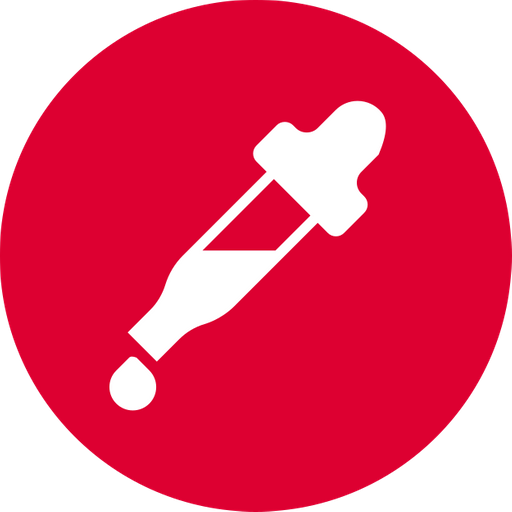
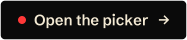
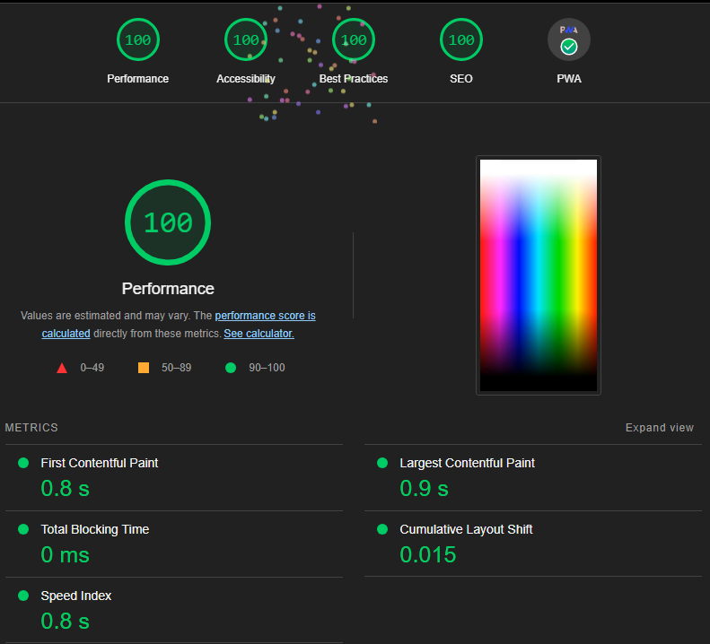

<a id="top"></a>

<div align="center">



<h1>color-picker</h1>

<p>
  <strong>A full-page color picker: move the mouse to read a color and click to copy it.</strong><br />
  <sub>Plain HTML, CSS and JavaScript, no dependencies</sub>
</p>

<p>
  <a href="https://voaneves.github.io/color-picker/"><picture><source media="(prefers-color-scheme: dark)" srcset="https://raw.githubusercontent.com/voaneves/color-picker/main/assets/buttons/live-dark.svg" /></picture></a>
  <a href="#getting-started"><picture><source media="(prefers-color-scheme: dark)" srcset="https://raw.githubusercontent.com/voaneves/color-picker/main/assets/buttons/start-dark.svg" /></picture></a>
</p>

<p><sub>Need something like this? <a href="https://voaneves.com/en/#contact"><strong>Let's talk →</strong></a></sub></p>

<p>
  <a href="https://github.com/voaneves/color-picker/blob/main/LICENSE"></a>
  
</p>

<p>
  <a href="https://voaneves.github.io/color-picker/">Live demo</a> ·
  <a href="#features">Features</a> ·
  <a href="#getting-started">Getting started</a> ·
  <a href="#to-do">To do</a> ·
  <a href="#contact">Contact</a>
</p>

</div>

<picture>
  <source media="(prefers-color-scheme: dark)" srcset="https://raw.githubusercontent.com/voaneves/color-picker/main/assets/brand/rule-dark.svg" />
  <source media="(prefers-color-scheme: light)" srcset="https://raw.githubusercontent.com/voaneves/color-picker/main/assets/brand/rule-light.svg" />
  
</picture>

## About the project

Move the mouse across the page to see a color's RGB value as text, then click to copy it to your clipboard.

<p align="center">
  <a href="https://voaneves.github.io/color-picker/">
    
  </a>
</p>

The picker covers colors from black to white; clicking any color copies it and shows a confirmation message on screen. It is hosted on GitHub Pages.

**Demo:** <https://voaneves.github.io/color-picker/>

### Technologies

HTML, CSS and JavaScript, with no dependencies. The page works across platforms and has the Lighthouse score below.

<p align="center">
  
</p>

## Features

- An easy-to-use picker with all the RGB colors.
- Click to copy a color to your clipboard.
- Styling focused on accessibility, using maximum contrast.

## Getting started

1. Clone the repository:

   ```bash
   git clone https://github.com/voaneves/color-picker.git
   ```

2. Open `index.html` in a web browser.
3. Move the mouse to select colors.
4. Click the selected color: a sliding notification shows which color you
   picked and copies it to the clipboard.

## To do

- [ ] Add a modal with instructions when the page opens
- [ ] Update the README images
- [x] Transform into a web app
- [x] Improve page structure, add `<meta>` tags, and optimize JavaScript delivery

## Reporting bugs

Found a bug? Check the [issues](https://github.com/voaneves/color-picker/issues) first; if it is not there, open a new one with a clear title, the steps to reproduce it and, if possible, screenshots. Pull requests are welcome too.

## Contact

<p>
  <a href="https://voaneves.com/en/#contact"><picture><source media="(prefers-color-scheme: dark)" srcset="https://raw.githubusercontent.com/voaneves/color-picker/main/assets/buttons/hire-dark.svg" /></picture></a>
  <a href="https://voaneves.com/en/"><picture><source media="(prefers-color-scheme: dark)" srcset="https://raw.githubusercontent.com/voaneves/color-picker/main/assets/buttons/site-dark.svg" /></picture></a>
</p>

<a href="https://linkedin.com/in/voaneves">LinkedIn</a> · <a href="mailto:victorneves478@gmail.com">E-mail</a>

<p align="center">
  
</p>

<p align="center"><sub>Released under the <a href="https://github.com/voaneves/color-picker/blob/main/LICENSE">MIT License</a>.</sub></p>

<p align="center"><sub><a href="#top">↑ Back to top</a></sub></p>
