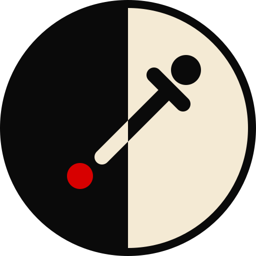
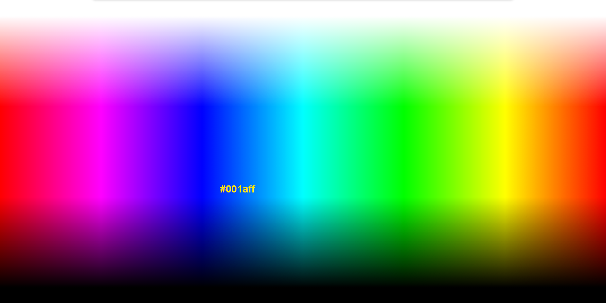
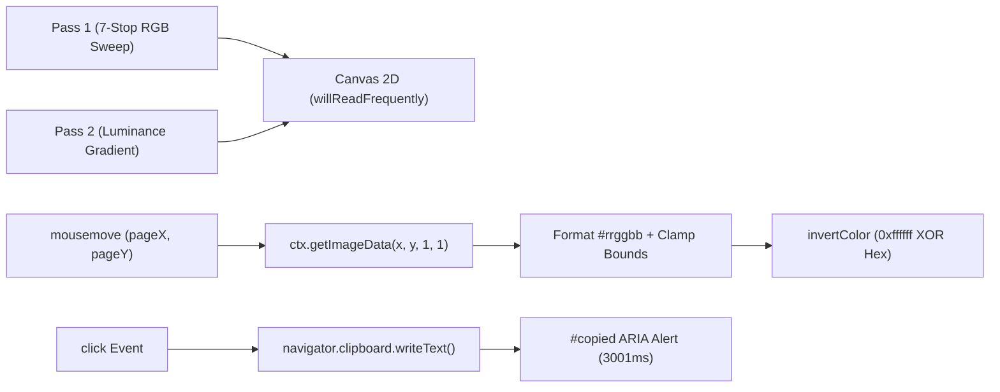

<a id="top"></a>

<div align="center">

<picture>
  <source media="(prefers-color-scheme: dark)" srcset="https://raw.githubusercontent.com/voaneves/color-picker/main/assets/logo/logo-dark.svg" />
  <source media="(prefers-color-scheme: light)" srcset="https://raw.githubusercontent.com/voaneves/color-picker/main/assets/logo/logo-light.svg" />
  
</picture>

<h1>color-picker</h1>

<p>
  <strong>Full-page Canvas 2D color picker: sweep your pointer across the spectrum to preview any RGB hue and click to copy its hex value.</strong><br />
  <sub>
    Installable zero-dependency PWA with bitwise contrast inversion and Lighthouse 100 scores —
    <kbd>HTML5 Canvas</kbd> · <kbd>SCSS</kbd> · <kbd>JavaScript</kbd> · <kbd>Clipboard API</kbd> · <kbd>PWA</kbd>
  </sub>
</p>

<p>
  <a href="https://voaneves.github.io/color-picker/"><picture><source media="(prefers-color-scheme: dark)" srcset="https://raw.githubusercontent.com/voaneves/color-picker/main/assets/buttons/live-dark.svg" /></picture></a>
  <a href="#getting-started"><picture><source media="(prefers-color-scheme: dark)" srcset="https://raw.githubusercontent.com/voaneves/color-picker/main/assets/buttons/start-dark.svg" /></picture></a>
</p>

<p><sub>Need something like this? <a href="https://voaneves.com/en/#contact"><strong>Let's talk →</strong></a></sub></p>

<p>
  <a href="https://github.com/voaneves/color-picker/blob/main/LICENSE"></a>
  
  
</p>

<p>
  <a href="https://voaneves.github.io/color-picker/">Live demo</a> ·
  <a href="#features">Features</a> ·
  <a href="#architecture">Architecture</a> ·
  <a href="#getting-started">Getting started</a> ·
  <a href="#contact">Contact</a>
</p>

</div>

<picture>
  <source media="(prefers-color-scheme: dark)" srcset="https://raw.githubusercontent.com/voaneves/color-picker/main/assets/brand/rule-dark.svg" />
  <source media="(prefers-color-scheme: light)" srcset="https://raw.githubusercontent.com/voaneves/color-picker/main/assets/brand/rule-light.svg" />
  
</picture>

<a id="features"></a>
## About the project

Turn the entire browser viewport into a full-bleed color canvas where moving your cursor reads pixel RGB hex codes in real time and clicking copies the selected swatch to your clipboard.

Demo: <https://voaneves.github.io/color-picker/>

<p align="center">
  <a href="https://voaneves.github.io/color-picker/">
    
  </a>
</p>

### Two-pass `<canvas>` spectrum &amp; XOR contrast inversion

`setCanvasSize()` draws 7 horizontal RGB color stops overlaid by a vertical white/transparent/black luminance ramp (`willReadFrequently: true`). On cursor movement, `getImageData()`[^1] extracts the exact pixel and `invertColor()` computes the 24-bit bitwise XOR complement (`0xffffff ^ parseInt(hexValue, 16)`) so both the floating `#hex` label and toast banner remain readable across every color from `#ffffff` to `#000000`.

### One-click copy &amp; Lighthouse 100 showcase

<table>
  <tr>
    <td width="50%" align="center" valign="top">
      <br />
      <sub><strong>Interactive Pick &amp; Copy</strong> — shown in the onboarding modal (<code>#modal-one</code>) until dismissed</sub>
    </td>
    <td width="50%" align="center" valign="top">
      <a href="https://googlechrome.github.io/lighthouse/viewer/?psiurl=https%3A%2F%2Fvoaneves.com%2Fcolor-picker%2F&strategy=mobile&category=performance&category=accessibility&category=best-practices&category=seo&category=pwa&utm_source=lh-chrome-ext">
        
      </a><br />
      <sub><strong>100</strong> Performance, Accessibility, Best Practices, SEO &amp; PWA</sub>
    </td>
  </tr>
</table>

<a id="architecture"></a>
## Pixel-sampling flow &amp; PWA caching



<dl>
  <dt><strong>Bounds clamping &amp; ARIA toast (<code>scripts/main.js</code>)</strong></dt>
  <dd><code>adjustHexPosition()</code> keeps the floating label inside viewport bounds near edges, while clicking writes via <code>navigator.clipboard.writeText()</code>[^2] and slides in a <code>role="alert"</code> <code>aria-live="assertive"</code> notification for <code>3001ms</code>.</dd>
  <dt><strong>Offline Service Worker (<code>sw.js</code> → <code>worker.js</code>)</strong></dt>
  <dd>Pre-caches <code>["/"]</code> into <code>precache-v1</code> on install and serves same-origin assets cache-first via <code>runtime</code> alongside <code>manifest.json</code>.</dd>
</dl>

<a id="getting-started"></a>
## Getting started

> [!TIP]
> Serve over `http://localhost` rather than `file://` so the Clipboard API and Service Worker register cleanly in a secure origin.

```bash
git clone https://github.com/voaneves/color-picker.git
cd color-picker
python -m http.server 8000
```

Open `http://localhost:8000`, dismiss the onboarding modal, sweep your pointer across the spectrum, and click to copy any `#rrggbb` color.

### To do

- [x] Full-bleed Canvas 2D RGB + luminance spectrum with auto-inverted cursor hex label
- [x] Onboarding modal with animated GIF (`#modal-one`) and `localStorage` persistence (`isModalDismissed`)
- [x] Installable PWA (`manifest.json`, Service Worker, semantic `<meta>` tags, minified JS)
- [ ] Add modal instructions button and support additional readouts (RGB / HSL / OKLCH)

<a id="contact"></a>
## Contact

<p>
  <a href="https://voaneves.com/en/#contact"><picture><source media="(prefers-color-scheme: dark)" srcset="https://raw.githubusercontent.com/voaneves/color-picker/main/assets/buttons/hire-dark.svg" /></picture></a>
  <a href="https://voaneves.com/en/"><picture><source media="(prefers-color-scheme: dark)" srcset="https://raw.githubusercontent.com/voaneves/color-picker/main/assets/buttons/site-dark.svg" /></picture></a>
</p>

<a href="https://linkedin.com/in/voaneves">LinkedIn</a> · <a href="mailto:victorneves478@gmail.com">E-mail</a>

<p align="center">
  
</p>

<p align="center"><sub>Released under the <a href="https://github.com/voaneves/color-picker/blob/main/LICENSE">MIT License</a> © 2026 <a href="https://github.com/voaneves">Victor Neves</a> · <strong>VOANEVES.</strong></sub></p>

<p align="center"><sub><a href="#top">↑ Back to top</a></sub></p>

[^1]: Pixel sampling initializes `canvas.getContext('2d', { willReadFrequently: true })` in `scripts/main.js` to avoid GPU readback stalls.
[^2]: Uses `navigator.clipboard.writeText(currentHex)` paired with transient pointer-lock state during the toast animation.
